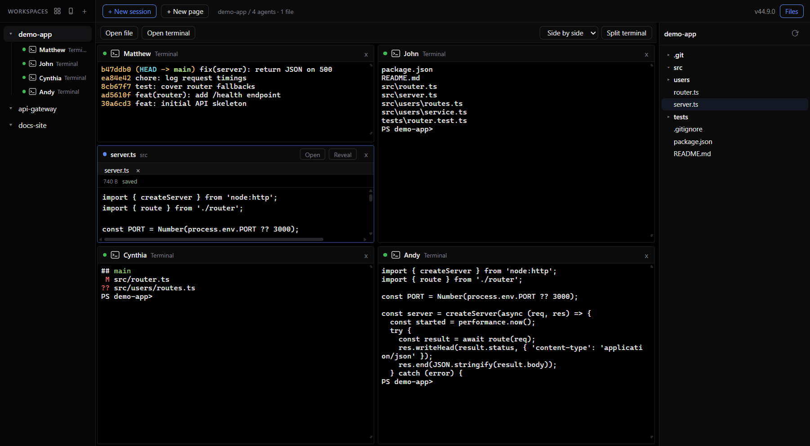
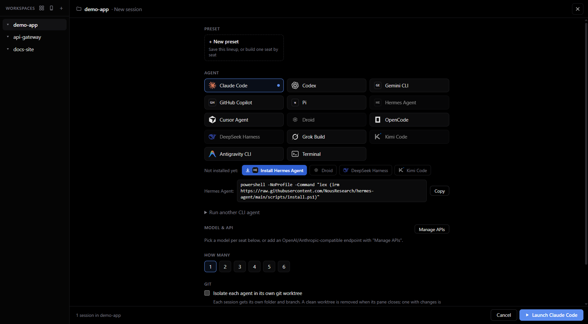

<div align="center">



<p>
  <a href="#download"></a>
  
  
  <a href="LICENSE"></a>
</p>

<p>
  <a href="#features">Features</a> ·
  <a href="#screenshots">Screenshots</a> ·
  <a href="#install">Install</a> ·
  <a href="#build-from-source">Build</a> ·
  <a href="#mobile-access">Mobile access</a> ·
  <a href="#keyboard-shortcuts">Shortcuts</a>
</p>

</div>

**AgentSense is a desktop cockpit for coding agents.** Pick a workspace folder, open a grid
of terminal panes, and run Claude Code, Codex, Gemini CLI, Cursor Agent, OpenCode and
friends next to each other, each pane optionally isolated in its own git worktree.
Everything runs locally, works offline and stays on your machine.

<p align="center">
  
</p>

## Features

<table>
<tr>
<td width="50%" valign="top">

### 🧩 Agent panes
A terminal grid (xterm.js + node-pty) with repeatable splits in one window. Launch up to
6 seats at once, then split in as many extra terminals as you need.

</td>
<td width="50%" valign="top">

### 📚 Agent catalog
Claude Code, Codex, Gemini CLI, GitHub Copilot, Pi, Hermes Agent, Cursor Agent, Droid,
OpenCode, DeepSeek Harness, Grok Build, Kimi Code, Antigravity CLI and plain PowerShell.
Missing agents show their install command; **Run another CLI agent** launches anything else.

</td>
</tr>
<tr>
<td valign="top">

### 🌳 Git worktree isolation
Give a pane its own worktree (`<repo>.worktrees/<name>`, branch `agentsense/<name>`) so
agents never step on each other. Nothing is ever force-removed.

</td>
<td valign="top">

### 🗂️ Workspace pages & files
**+ New page** opens another page in the same folder, each with its own splits and file
previews. Resizable file explorer, drag-to-rearrange panes, layouts that survive restart.

</td>
</tr>
<tr>
<td valign="top">

### 📎 Drag files to agents
Drop files from the tree, a file tab or Windows Explorer onto a pane. They are copied into
that session's working directory (worktrees included) and the quoted path is pasted into
the prompt, without pressing Enter.

</td>
<td valign="top">

### 📱 Mobile access
Pair your phone with a QR code and drive the same sessions from its browser: watch, type,
start a new agent, close a session. Works over LAN or Tailscale. Or use a
[Telegram bot](#telegram-bot) from any network, with notifications when an agent needs you.

</td>
</tr>
<tr>
<td valign="top">

### 🎛️ Presets, models & APIs
Save a lineup ("2× Claude + 1× Codex") and relaunch it in one click. Pick a model or a
third-party OpenAI/Anthropic-compatible endpoint per seat, with per-session env injection.

</td>
<td valign="top">

### 🚦 Live status & restore
A local, token-protected hook server turns Claude Code events into pane status
(`working → waiting → done`). Panes and sessions come back per workspace after restart.

</td>
</tr>
</table>

**Local-first:** data lives in `%APPDATA%\AgentSense`. No account, no telemetry, fully offline.

## Screenshots

<table>
<tr>
<td width="50%"></td>
<td width="50%"></td>
</tr>
<tr>
<td align="center"><sub><b>Launch page</b>: pick agents, seats, models and worktree isolation</sub></td>
<td align="center"><sub><b>Workbench</b>: split terminals, file preview and explorer side by side</sub></td>
</tr>
</table>

## Download

**[Download AgentSense v1.0.0-beta.2](https://github.com/quanw12/agentsense/releases/tag/v1.0.0-beta.2)** for
Windows x64: get `AgentSense-v1.0.0-beta.2-windows-x64.zip` from the release's Assets, then follow
[Install](#install). `SHA256SUMS.txt` on the same page has the checksums.

> [!NOTE]
> This is a preview release and the app is not code-signed. You can also
> [build from source](#build-from-source) in a few commands.

## Install

From a distribution zip:

1. Unzip the whole zip, then double-click **`Install AgentSense.cmd`**.
2. If Windows shows *"Windows protected your PC"*, click **More info → Run anyway**
   (the app is not code-signed).
3. AgentSense appears in the Start Menu and on the Desktop, installed for your Windows
   user only. No administrator rights needed.
4. To uninstall, double-click **`Uninstall AgentSense.cmd`** (your data in
   `%APPDATA%\AgentSense` is kept).

Coding agents (Claude Code, Codex, …) are installed separately; Claude Code on Windows
needs [Git for Windows](https://git-scm.com/download/win). The plain **Terminal** pane works
without any of them. See [README.txt](README.txt) for the step-by-step guide shipped in the zip.

## Build from source

Requirements: **Node.js ≥ 20** and npm. No Visual Studio needed: the only native
dependency (`node-pty`) ships N-API prebuilds.

```bash
git clone https://github.com/quanw12/AgentSense.git
cd AgentSense
npm install
npm run start
```

| Command | What it does |
| --- | --- |
| `npm run start` | Run the app in development |
| `npm run smoke:workbench` | Real Electron/terminal checks for pages, explorer, drops and worktrees |
| `npm run smoke:mobile` | End-to-end check of the mobile server (auth, attach, input, create, kill) and the pairing panel. Briefly listens on all interfaces, so Windows Firewall may ask once |
| `npm run check:telegram` | Telegram bot checks against a fake Bot API (pairing, who it obeys, input, files) |
| `npm run smoke:telegram` | Telegram bot end to end with a real pane; only the Telegram server is faked |
| `npm run screenshots` | Recapture the README screenshots from a throwaway profile |
| `npm run icons` | Repack `build/icon.png` + `build/icon.ico` from `assets/icon.png` |
| `npm run dist` | Build `dist/win-unpacked` with electron-builder |
| `npm run build:app` | Rebuild, verify hashes, and stage `app/` for the installer |

Then double-click `Install AgentSense.cmd` (or run `dist\win-unpacked\AgentSense.exe` directly).

The feature-by-feature comparison with the Orca references, validation details and current
limits are in [docs/orca-workbench.md](docs/orca-workbench.md).

## Mobile access

AgentSense can serve a touch-friendly web UI from the desktop, so your phone becomes a
remote control for the sessions running on your PC.

1. Click the **phone icon** in the sidebar header and turn on **Enable mobile access**.
2. Turn on **Reachable from other devices**. It is off by default, and while it is off the
   server listens on this PC only, so the panel shows no QR code or links.
3. Scan the QR code with your phone (or copy one of the links). The link contains a random
   pairing token, stored in `%APPDATA%\AgentSense\mobile.json`.
4. Tap a session to get a full-screen terminal with a quick-keys bar
   (Esc / Tab / arrows / `^C` / `^D` / Enter). Toggle **Line** to send a whole line per
   Enter, the most reliable way to type (and paste) on a phone keyboard. **+ New** starts an
   agent in any workspace; panes created on the phone appear on the desktop right away, and
   the other way round.
5. While mobile access is on, enable **Keep the PC awake** so sessions survive idle.

**Where the phone can reach the PC**

- **Same Wi-Fi / LAN**: works once "Reachable from other devices" is on. Windows may then ask
  to allow AgentSense through the firewall; allow it on private networks.
- **Away from home**: install [Tailscale](https://tailscale.com) (free) on **this PC and your
  phone**, join the same tailnet, and keep "Reachable from other devices" on. The phone
  reaches the PC by its Tailscale address (`100.x.x.x`, listed in the panel) over an
  encrypted WireGuard tunnel.

The panel lists every address of this PC. The QR code uses the one a phone is most likely to
reach, guessed from the adapter name and address: Wi-Fi, then wired, then other private
networks, then Tailscale or another VPN. Adapters for WSL, Hyper-V, VMware and similar come
last and are never put in the QR code. If the QR code does not connect, for example when you
are away from home on Tailscale, open the link for the right adapter instead.

> [!WARNING]
> **Do not port-forward this page to the internet.** It is plain HTTP and is meant for
> LAN/VPN use only.

**Security:** every request (page and WebSocket) requires the 32-hex pairing token, compared
in constant time; three wrong tokens lock new connections out for 30 seconds. **Rotate
pairing token** invalidates the old QR and link. The phone can only pick workspaces and
agents you already configured on the desktop; it never sends filesystem paths. Desktop and
phone can drive the same pane at once (last writer wins).

## Telegram bot

Drive your panes from a Telegram chat, on any network the phone has. The bot only makes
outgoing connections, so there is no port to open and no VPN to install. The PC still has to
stay on, online and running AgentSense, because that is where the agents run.

1. In Telegram, open **@BotFather**, send `/newbot` and copy the token.
2. In AgentSense, click the **phone icon**, paste the token under **Telegram bot** and save.
3. Click **Get pairing code** and send the `/pair CODE` it shows to your bot.

| In the chat | What happens |
| ----------- | ------------ |
| Any message | Goes to the current pane. Reply to a screen message to send to that pane instead. |
| `/compact` and other unknown commands | Go to the pane, so an agent's own commands still work |
| `/send /help` | Sends text as is, for names the bot also uses |
| `/panes`, `/screen` | Pick a pane, see its screen. The screen keeps updating while the agent works. |
| `/new`, `/close` | Start an agent in a saved workspace, close a pane (after a confirm button) |
| `/diff` | `git status` and the diff against `HEAD` |
| `/ls [folder]`, `/cat <file>` | Browse the workspace. Long output arrives as a file. |

Screen messages have buttons for Enter, Esc, Ctrl+C, arrows and 1/2/3, which is enough to answer
most agent prompts. Claude Code panes also notify you when they finish or need you; other agents
have no hooks, so they only report when they exit.

> [!WARNING]
> Whoever is paired can run anything on this PC through your agents. Telegram bot chats are
> **not end-to-end encrypted**: screens, diffs and files you open pass through Telegram's
> servers. Do not use this for code or secrets that must stay private.

**Security:** the bot obeys one Telegram user, set by a one-time code that expires in 10 minutes
and is burned after 5 wrong tries. Everyone else, and every group, gets silence. Messages sent
while the app was off are dropped and late deliveries are refused, so a queued prompt cannot fire
hours later. Forwarded messages are not sent to agents. `/cat` stays inside the workspace and
refuses common credentials files (`.env`, keys, `.git/`), but that list cannot be complete, and
agent output and diffs are not filtered. The token is encrypted with Windows DPAPI in
`%APPDATA%\AgentSense\telegram.json` and is never shown again.

The screen is the pane's current size, so a wide pane wraps on a phone. For close work, use
[Mobile access](#mobile-access) over Tailscale, which has a full terminal and stays encrypted end to end.

## Keyboard shortcuts

| Shortcut | Action |
| --- | --- |
| <kbd>Ctrl</kbd>+<kbd>Tab</kbd> / <kbd>Ctrl</kbd>+<kbd>Shift</kbd>+<kbd>Tab</kbd> | Next / previous page |
| <kbd>Ctrl</kbd>+<kbd>Shift</kbd>+<kbd>E</kbd> | Toggle the file explorer |
| <kbd>Ctrl</kbd>+<kbd>+</kbd> / <kbd>-</kbd> / <kbd>0</kbd> | Zoom in / out / reset |
| <kbd>F11</kbd> | Fullscreen |
| Double-click a pane title | Maximize / restore the pane |

## Project layout

```text
main.js / preload.js     Electron main process + contextBridge API (window.hub)
src/main/                pty manager, workspaces, sessions, worktrees, hook server,
                         mobile access server, state store
src/renderer/            UI: sidebar, launch page, terminal grid, file panel, dashboard,
                         mobile access panel (vanilla JS + xterm)
src/mobile/              phone page served by the mobile access server (vanilla JS + xterm)
assets/                  brand mark (icon.png 512 + icon-256.png for the .ico)
build/                   app icons (generated: npm run icons)
docs/media/              README logo and screenshots
scripts/                 build helpers, smoke tests and the screenshot capture
app/                     generated Electron payload shipped in the distribution zip
install.ps1 / uninstall.ps1 + Install/Uninstall .cmd   per-user installer
```

## Contributing

Issues and PRs are welcome. Short version: branch per task
(`feat/…`, `fix/…`, `docs/…`, `build/…`, `chore/…`), conventional commits, merge with
`--no-ff`. See [CONTRIBUTING.md](CONTRIBUTING.md).

## License

[MIT](LICENSE) © Anh Quân (quanw12)
